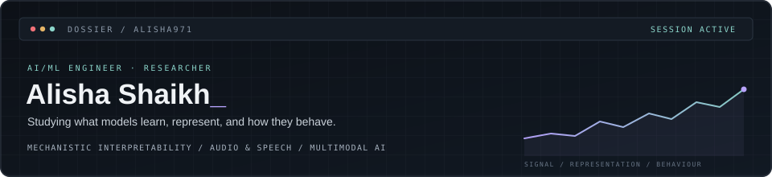

  

Hey, I'm Alisha! I'm interested in both understanding how machine learning models learn, represent information, and behave, and building useful AI systems around them. I've explored mechanistic interpretability and audio and conversational behaviour, while also working on RAG and agentic research workflows, predictive applications, model-serving infrastructure, and backend systems. I like moving between research questions and hands-on engineering: testing ideas carefully, building things that work, and learning how to make them more reliable.

[Repositories](https://github.com/alisha971?tab=repositories) · [Research](#01--research) · [Engineering](#02--engineering) · [Tools](#03--tools--technologies) · [Activity](#04--github-activity)

---

## 01 / Research

| **Project** | **Focus** |
|---|---|
| [Soccer MI](https://github.com/alisha971/soccer_mi) | Studies player prediction from soccer event sequences, comparing statistical baselines—including class and zone priors, Markov models, and logistic regression—with transformer sequence models across contexts and model depths. |
| [CODA](https://github.com/alisha971/coda) | A controlled measurement study testing whether a conversation partner’s prosodic delivery predicts the reply’s delivery beyond text, using speaker-held-out evaluation. |
| [Audio Processing Notes](https://github.com/alisha971/intro_to_audio_processing) | A practical learning journal with notes and notebooks on sampling, spectrograms, pitch, prosody, feature extraction, and research-paper reading guides. |

**Current research interests**

- Mechanistic interpretability and internal representations
- Audio and speech processing, especially prosody
- Multimodal learning and model behaviour
- Experimental design, evaluation, and reproducibility

---

## 02 / Engineering

I build AI applications and backend systems, with an emphasis on clear interfaces, modular architecture, and reliable data flow.

| **Project** | **What it explores** |
|---|---|
| [Stratos](https://github.com/alisha971/Stratos-LLM-Based-Idea-Research-and-Analysis-Platform) | An agentic research prototype that guides idea clarification, gathers evidence, develops arguments for and against a claim, and produces a reasoned assessment with citations and unresolved questions. |
| [Nimbus Inference Service](https://github.com/alisha971/Nimbus-Inference-Service) | Cloud model serving on Google Cloud Run, with MLflow, Cloud SQL, Redis, model artifacts in cloud storage, and Celery-based asynchronous batch inference. |
| [PulseBoard](https://github.com/alisha971/Pulseboard-Analytics) | An event-driven productivity analytics platform combining separate API services, RabbitMQ message processing, PostgreSQL, Redis caching, background work, and a React dashboard. |
| [Asset Monitoring API](https://github.com/alisha971/asset-monitoring-api) | A Java and Spring Boot REST API modelling industrial assets, sensors, measurements, and alerts, with validation and a layered service/repository design. |
| [CampaignIQ](https://github.com/alisha971/CampaignIQ-Predictive-Analytics-for-Marketing-Success) | A predictive marketing analytics application combining a scikit-learn model pipeline with an interactive dashboard and AI-assisted interface. |

---

## 03 / Tools & Technologies

  

**Languages**

**Machine Learning**

**Backend & Infrastructure**

---

## 04 / GitHub Activity

  
  

  

---

## 05 / Contributions

  <picture>
    <source media="(prefers-color-scheme: dark)" srcset="https://raw.githubusercontent.com/alisha971/alisha971/output/github-snake-dark.svg" />
    <source media="(prefers-color-scheme: light)" srcset="https://raw.githubusercontent.com/alisha971/alisha971/output/github-snake.svg" />
    
  </picture>

---

Understand the model. Test the hypothesis. Build the system.
